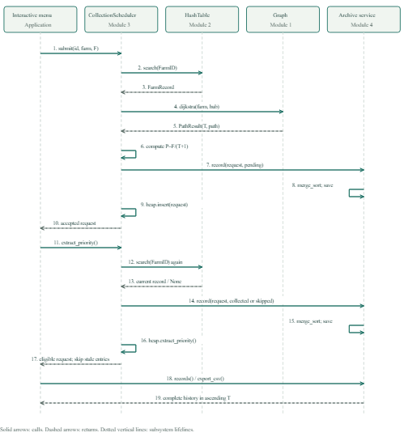

# COMP5008 - Farm Network, Hash Lookup, Heap Scheduling and Sorting

Author: Thanh Dat Nguyen
Student ID: 23857030
Date: 16/10/2026

This project implements the supplied **Sections 3-8 / four integrated modules** in Python.
It includes real WA farm records, a hypothetical Pinjarra biogas hub, a weighted
undirected graph, BFS levels, whole-network DFS cycle detection and Dijkstra
shortest routes, a manual hash table for complete farm lookup, and an integrated
binary Max Heap for feedstock collection scheduling, manual Merge Sort and Quick Sort,
and a persistent collection-record database ordered by transportation time.
Program output and source comments are in English.

## Run

Use **Python 3.10 or newer** with **NumPy** installed. No internet connection is required to run the app.

```bash
python -m pip install numpy
```

Extract the ZIP, open a terminal in `COMP5008_assignment_23857030`, then run:

```bash
python interactive_menu.py
```

On Windows, `py` can replace `python`. On macOS/Linux, `python3` can replace it.
You can also run the script by its absolute path from another working directory;
input data is located relative to the script, rather than the current directory.

```bash
python interactive_menu.py --integrated-demo
python integration_demo.py --delete-farm doj25
python interactive_menu.py --demo
python interactive_menu.py --network full --demo
python interactive_menu.py --validate
python interactive_menu.py --network full --validate
python interactive_menu.py --module hash
python interactive_menu.py --module hash --demo
python interactive_menu.py --module hash --validate
python interactive_menu.py --module heap
python interactive_menu.py --module heap --demo
python interactive_menu.py --module heap --validate
python interactive_menu.py --module sort
python interactive_menu.py --module sort --demo
python interactive_menu.py --module sort --validate
python -m module4_sorting.benchmark
python -m module4_sorting.test_driver
python -m module2_hash.test_driver --count 40
python -m module3_heap.test_driver
python -m unittest discover -s module1_graph/tests -v
python -m unittest discover -s module2_hash/tests -v
python -m unittest discover -s module3_heap/tests -v
python -m unittest discover -s . -v
```

`--demo` prints results for the selected module and exits. Graph mode is the
default. `--validate` checks the graph specification, or confirms at least 40
unique complete searchable records in hash mode. Sort validation checks both
algorithms on all nine input cases, including record preservation and stable
Merge Sort ties. Heap validation checks operations and edge cases. It returns 0 on success and
1 on failure. Missing or invalid CSVs produce an
actionable error and exit code 1. `--data-dir PATH` selects a different data
directory with the same file schemas.

## Four-module integration and UML

The final system is one modular application. Root menus 10/11/12 use the same
farm Hash Table and collection archive; graph results feed request priorities.
The scheduler retrieves a complete FarmRecord, calls manual Dijkstra for T/path,
calculates P, inserts into its Max Heap, and records the snapshot/status in
Module 4. The archive uses manual sorting by ascending T before SQLite storage.
Deleting a farm in Module 2 affects the queued request in Module 3 while its
historical snapshot remains available to Module 4.



The diagram uses subsystem lifelines, calls, returns and self-messages. Module
3 contains MaxHeap; Module 4's archive participant represents SessionRecorder
and CollectionDatabase. [Editable UML](docs/module_integration_uml.puml),
[vector diagram](docs/module_integration_uml.svg) and
[interaction details](docs/INTEGRATION.md) are included.

Run one complete, reproducible scenario:

```bash
python interactive_menu.py --integrated-demo
python integration_demo.py --network full
python integration_demo.py --delete-farm doj25
python -m unittest discover -s integration_tests -v
```

Root option 13 runs the same demonstration. It uses actual shared module
instances in a fresh session and exports a complete log, eight validation
checks, sorted CSV and SQLite history under `collection_output/integration/`.
It does not clear the active interactive queue or live archive. A repeated
command regenerates its derived integration evidence. The submitted normal
scenario is in `sample_output/integration/`: ten inserted, ten extracted and
ten archived/collected. Its `deleted_farm/` scenario archives all ten requests
but collects nine and retains the deleted farm's request as `skipped`.

The refactored suite has **239 passing tests**:
cases for manual storage, codecs and restriction scanning. Every Python source/test file has an author,
date and purpose header. The final technical report follows the required nine
sections: System Overview; Dataset and Data Preparation; Data-Structure
Justification; Module Integration; Algorithm Complexity; Experimental Results, Reflection, Limitations, AI Declaration.
It has **18 A4 pages total: 1 declaration page, 15 main pages, 1 references page and 1 appendix page**.

## Two supplied networks

| Mode | Farm vertices | Hub vertices | Total vertices | Undirected edges | Isolated farms |
|---|---:|---:|---:|---:|---:|
| `test` (default) | 11 | 1 | 12 | 18 | 1 |
| `full` | 125 | 1 | 126 | 254 | 1 |

Both contain positive minute weights, cycles and exactly two connected
components. `gslqa` (Chapman Valley Feedlot) is deliberately isolated to exercise
the required failure case. This is a **modelling decision**, not evidence of
actual road inaccessibility. All other supplied vertices can reach the hub.
The smaller test network is the main marking/demo example; full mode shows
that all 125 source records can be used by the same graph implementation.

## Interactive menu

| Option | Action |
|---|---|
| 1 | List location IDs and check the test-graph specification |
| 2 | Print the graph's adjacency lists, including isolates |
| 3 | BFS: group reachable locations by edge count from the source |
| 4 | DFS: inspect all components, report a cycle and its location IDs |
| 5 | Dijkstra: minimum-minute route, leg times and total time |
| 6 | Insert another real farm from `dataset.csv` into the current graph |
| 7 | Insert a positive weighted edge in both directions |
| 8 | Reload `test` or `full`, resetting graph and scheduling sessions |
| 9 | Print all demonstration results for the current graph |
| 10 | Open Module 2: hash-based farm lookup |
| 11 | Open Module 3: heap-based feedstock collection scheduling |
| 12 | Open Module 4: sorted collection database and sorting benchmarks |
| 13 | Run a fresh end-to-end demonstration of all four real modules |
| 0 | Exit |

Enter an exact ID, for example `doj25`, rather than a farm name. Press Enter at
the source prompt to use `HUB_PINJARRA`. IDs are case-sensitive. Distinct farms
can share a name; names are not unique keys. Menu insertions are in memory.
The original and prepared CSVs are not rewritten by the interactive menu.

Try option 5, Enter, then `f4386`: on the test network the route is
`HUB_PINJARRA -> c81cd -> f4386`, taking **54 minutes = 30 + 24**.
Use destination `gslqa` for an unreachable location, or `NOT_A_LOCATION` for
an invalid location. An isolated source reaches itself in zero minutes.

For dynamic insertion, use option 6 with `3d8af`, then option 7 to connect it
to `HUB_PINJARRA` with a positive modelled weight. Re-inserting an existing ID
or edge produces an error; it does not change the existing graph.

## Module 2: hash-based farm lookup

Open root-menu option **10**, or run `python interactive_menu.py --module hash`.
The hash module loads all **125 complete farm records** from the same dataset.
Each `FarmRecord` contains all eleven minimum fields and all nine additional
source fields. The hypothetical hub is not inserted into the farm lookup.

The core index in `module2_hash/hash_table.py` is one NumPy object array, with slots
holding a record, `EMPTY`, or `DELETED`. It uses no built-in dictionary/map,
set or built-in `hash()` as its index. Its polynomial modulo hash is:

```text
h = 0
for each character c in FarmID:
    h = (31 * h + ord(c)) % capacity
probe i: (h + i) % capacity
```

The initial capacity is 11. Before an insertion would exceed active load 0.70,
the table grows to the next prime at or above twice its current capacity
(or a larger capacity needed by a custom threshold), then rehashes live records.
The observed 125-record import grows **11 -> 23 -> 47 -> 97 -> 197** before
insertions **8, 17, 33 and 68**. Final active load is **125/197 = 0.6345**.

`insert(record)` rejects a duplicate FarmID and retains the original record.
`search(FarmID)` returns the complete record or `None`. `delete(FarmID)` returns
the removed record or `None`. The UI prints clear not-found messages for both
missing searches and missing deletions.

Deletion leaves a **tombstone**, so searches continue across a removed cluster
member. Insertion remembers the first tombstone but still checks later slots
for duplicates before reusing it. Occupied load includes tombstones; if a new
insertion would push occupied load above 0.85 while active load still fits,
a same-capacity rehash clears them. The gap from active-load threshold 0.70
avoids expensive cleanup on every delete/insert pair near that limit.
Deletion does not shrink the table.

Every tenth **successful public insertion** creates a load checkpoint. The
driver and menus display these checkpoints; internal rehash moves and rejected
duplicates do not count as user insertions. Reinsertions after a deletion do.
The checkpoint displays active count and occupied count separately from the
lifetime successful-insertion count. The core retains only the latest events;
reporting code retains import history outside the lookup index.

| Hash-menu option | Action |
|---|---|
| 1 | Current table statistics and original CSV import checkpoints |
| 2 | Search with complete farm fields and probe sequence |
| 3 | Insert/reinsert a source farm by its original FarmID |
| 4 | Delete a FarmID and show the updated load factors |
| 5 | Inspect slot contents, including tombstones |
| 6 | Run the collision and bulk-insertion driver on fresh demonstration tables |
| 7 | Reload the source CSV into a fresh hash session |
| 0 | Leave Module 2; root-menu entry returns to Module 1 |

All imported records are initially present, so option 3 mainly demonstrates
duplicate rejection or reinsertion after a deletion. The graph and hash
sessions are independent. Selecting a source record to insert may scan the
source tuple; normal `search(FarmID)` probes only the hash index.

The explicit collision demonstration uses two real records: `3d8af` and
`71a14` both hash to slot 5 with capacity 11. The second probes **5 -> 6**.
Deleting `3d8af` leaves slot 5 `DELETED`; searching `71a14` still probes
**5 -> 6** and succeeds. The driver prints the states before/after each step,
rejects a duplicate beyond that tombstone, and shows tombstone reuse.

See `module2_hash/README.md` for the short design justification, table-size
reasoning and performance limits. Expected search/delete and amortized
insertion are O(1) with five-character keys, suitable hash distribution and
bounded occupied load. An ordinary worst-case probe can inspect O(m) slots.
A rehash is expected O(m+n), including array allocation/scanning; growth has
m proportional to n. Adversarial clustering can make a rehash O(m+n*m),
or O(n^2) when m is proportional to n. Prime sizes do not prevent
collisions or the primary-clustering limitation of linear probing.

## Module 3: heap-based collection scheduling

Open root-menu option **11**, or run `python interactive_menu.py --module heap`.
The scheduler retrieves the complete farm record through the actual Module 2
Hash Table, then calls Module 1 Dijkstra from that FarmID to the processing hub.
It calculates `P = F / (T + 1 minute)` and inserts the request into a manual
array-based **Max Heap**. No manual priority value or built-in heap algorithm
is used. More feedstock raises P; longer transport reduces P. T=0 gives P=F.
Exact priority ties use FIFO insertion order, with full-precision comparisons.

`data/collection_requests.csv` supplies **10 educational requests**, using real
source FarmIDs and model quantities from 6 to 27.5 tonnes. The feedstock values
are invented assignment scenarios, not figures reported by Farm Transparency
Project. `collection_request_edge_cases.csv` contains invalid/duplicate query
scenarios. Neither file changes source farm records or their original IDs.

The default demo performs **10 heap insertions and 10 extractions**, prints
every resulting array and percolation swap, logs each priority computation and
shows the collection order. The test-network order is:

```text
C001 -> C004 -> C003 -> C008 -> C002 -> C006 -> C007 -> C009 -> C010 -> C005
```

Only one outstanding request per farm is allowed, avoiding double-counting
available feedstock. RequestIDs are unique for the scheduling session, including
already processed requests. A collected farm may receive a new RequestID.
Rejected requests do not consume IDs. Reset explicitly with submenu option 7
to start a new session.

An unreachable farm is rejected with a no-route message. Missing/deleted farm
records, invalid IDs and non-positive/non-finite/non-numerical quantities are
rejected. Empty heap operations are safe. If a farm is deleted or its record
changes after queuing, peek reports the stale root without removal; extraction
removes/skips stale requests and returns the next eligible request. Each
removal still prints its heap state and skipped requests are not collections.

The root hash and scheduling menus share the same Hash Table. Deletion in
Module 2 is visible to Module 3, and a hash reload rebinds the scheduler to the
new index. Priorities are snapshots for one graph configuration: vertex/edge
additions require a scheduling reset, and network reload resets the queue.

| Scheduling option | Action |
|---|---|
| 1 | Load `collection_requests.csv` |
| 2 | Submit a RequestID, FarmID and educational feedstock quantity |
| 3 | Peek without removing |
| 4 | Extract the highest eligible request |
| 5 | Drain eligible requests and display their order |
| 6 | Display the indexed heap array |
| 7 | Reset queue and request-ID history |
| 8 | Run an independent demonstration using fresh graph/hash structures |
| 9 | Delete a farm from the shared hash table to test stale requests |
| 0 | Leave Module 3 |

Heap parent/child indices are `(i-1)//2`, `2*i+1` and `2*i+2`. Sifting is
O(log q); peek is O(1). The mandatory full-array trace adds O(q) output work
per heap mutation. Request preparation also includes the existing Dijkstra
cost. See `module3_heap/README.md` for API contracts, duplicate policy,
zero-time fixture, complete edge-case handling and complexity details.

Evidence files include `heap_demo.txt`, `heap_traces.txt`,
`heap_priority_calculations.csv`, `heap_collection_order.csv`,
`heap_validation.json`, `heap_interactive_session.txt` and `heap_initial.png`
under `sample_output/`. Use `--module heap --network full --demo` to apply the
same quantities to the larger network; shortest times and priorities differ.

## Module 4: sorting collection records

Open root-menu option **12**, or run `python interactive_menu.py --module sort`.
Both algorithms sort **Estimated Transportation Time (T) in ascending order**.
The implementation uses no built-in sorting function. Bottom-up Merge Sort is
stable. Quick Sort uses median-of-three pivot keys and three-way partitioning;
it is unstable. It processes the smaller partition first and defers the larger
partition on an explicit stack, avoiding recursive stack overflow.

The normal interactive scheduler now archives every accepted request to
`collection_output/collection_records.sqlite3`, with its complete farm snapshot,
calculated time/priority, path and status. Collection changes its status to
`collected`; a deleted/changed farm remains as `skipped` history. Explicit reset,
network reload and application exit mark outstanding requests `cancelled`.
Session-prefixed RecordIDs preserve requests when a new session reuses a
RequestID. Invalid submissions remain rejection messages rather than accepted
collection records. Independent demo commands use fresh, isolated structures.

SQLite stores integer positions **calculated by the manual sorter**. It does not
sort the transportation times or run SQL `ORDER BY`. Reading explicit positions
0, 1, ... reconstructs the saved order. Module 4 can display, re-sort and export
this history. A CSV export is saved in `collection_output/`. Use `--output-dir
PATH` to choose a separate persistent database and exports directory. Starting
Module 3 again creates a new session; historical records remain available.

Run the submitted benchmark from the project root:

```bash
python -m module4_sorting.benchmark
python -m module4_sorting.benchmark --seed 23857030 --repeats 7 --number 25
python -m unittest discover -s module4_sorting/tests -v
```

The benchmark tests **100, 500 and 1,000 records**, each under **random, nearly
sorted and reversed** conditions. The fixed seed is **23857030**. It generates
1,000 unique historic request events at the 124 reachable real farms; repeated
farm IDs represent separate events, not invented farms or concurrent pending
requests. Every T and route comes from actual Module 1 Dijkstra calls after
Module 2 lookup. Module 3 validates the requests and calculates their priorities.
Farm `gslqa` is explicitly excluded because it has no route. Feedstock quantities
are educational 2-30 tonne scenarios, not reported production figures.

At each size all three conditions use the same records. Nearly sorted data is
made from our own stable Merge Sort result, with disjoint swaps affecting
exactly 10% of the record identities. Random shuffling and reversed order are
then tested independently. Input files are in `data/sort_inputs/`; both sorted
outputs for every case are in `sample_output/sorting/`.

The checked-in nearly-sorted inputs and their sorted sample outputs are
generated by the current `make_condition` implementation. Earlier files with
the same names may contain a different seeded arrangement; the CSV schema
does not encode a generator version. Reproduce the current arrangement with
seed 23857030 and the condition seed `seed + size*10 + 1`.

Timing uses `timeit`: one warm-up, then seven batches of 25 complete sorts for
each algorithm/case, reporting the median batch time divided by 25. Copies are
included, while graph/data generation, metrics, validation, printing and file
I/O are excluded. The input is unchanged for each call. Seeded data is
reproducible; elapsed time depends on the host and load. The measured table,
126 raw samples, interpreter/platform metadata, input hashes, correctness checks
and untimed comparison/partition counters are supplied. See
`module4_sorting/README.md` and the technical report for the actual results,
stability, pivot behaviour and theoretical versus observed complexity.

`sample_output/sorting/collection_records.sqlite3` contains 1,000 sorted modelled
records. A separate `live_collection_demo.sqlite3` and CSV retain all ten actual
Module 3 demonstration submissions: nine collected, one skipped after its farm
was deleted. The generated examples are separate from the interactive archive.

## Data provenance and FarmIDs

The region is **Western Australia, Australia**. The user-supplied CSV `data/farm_dataset_red_meat_WA.csv` has 125
records and all the required columns. It is not claimed to be a complete census of WA farms.

Three uploaded ID cells were in scientific notation. The original website IDs
were restored from the agreeing `Map URL` and `Profile URL` fields, with source
spot checks recorded in `data/source_verification.csv`:

| Uploaded ID cell | Exact website FarmID | Farm |
|---|---|---|
| `6.50E+31` | `65e30` | Paradise Beef Cattle Feedlot |
| `6.00E+64` | `60e63` | Lake Preston Cattle Feedlot |
| `8.00E+06` | `80e05` | Twyata Pool Feedlot |

`data/dataset.csv` preserves every other field value and row order. The full
change log is `data/id_corrections.csv`. This restores the website's IDs;
it does not renumber farms or numerically expand the corrupted cells. Keep
the `Id` column as **text** if opening or importing the CSV in a spreadsheet.
The loader rejects ID/source-URL mismatches rather than repairing them silently.

Some source address fields are blank (23 street numbers, 1 road, 3 suburbs and
3 postcodes). Blanks are retained. There are no missing IDs, names, species,
latitudes or longitudes. All coordinates are finite and within global bounds;
the supplied State and Country fields are WA and Australia throughout. One
source category is marked unconfirmed and is preserved as such. Five records
were spot-checked against public website listings; the remaining records have
URL/ID consistency checks, not a claimed independent website audit. Names,
addresses and operating status can differ from later website revisions.

## Hub and transport model

`HUB_PINJARRA` is a hypothetical processing hub at the student-selected
approximate town coordinate **(-32.6285, 115.8750)**. It is kept in `hub.csv`,
separate from source farms. Pinjarra places the demonstration near the selected
West Pinjarra, Nirimba, Nambeelup, Waroona and nearby farm cluster. No existing
biogas facility, approved site or optimal hub location is claimed.

For each selected connection:

1. Compute great-circle distance `d` with the haversine formula, using an Earth
   radius of 6,371 km and the supplied farm coordinates.
2. Estimate road distance as `1.30 * d` km.
3. Assume an average speed of `60 km/h`.
4. Set `TransportTime = max(1, ceil(60 * 1.30 * d / 60))` minutes.

The factor and speed are educational assumptions. Edge weights use full
precision before upward rounding; the CSV distance display is rounded to
nine decimal places. These are not observed trip times or road directions.
Connections need not correspond to direct public roads. Collection/loading
times, congestion, terrain, access permissions and truck capacities are not
represented.

The **test network** has 18 explicitly listed connections in
`module1_graph/build_network.py::TEST_PAIRS`. They provide alternative routes
and cycles through ten local farms and the hub. The eleventh farm, `gslqa`,
has no edges. `test_vertices.csv` records the selected original FarmIDs.

The **full network** excludes `gslqa` from connection candidates, starts a
connected component at the hub, and repeatedly attaches the remaining vertex
with the shortest current great-circle attachment. It then adds each eligible
vertex's three nearest neighbours as alternative undirected connections,
deduplicating pairs. ID tie-breaking makes regeneration deterministic.
The generated full network has 254 unique edges. This topology demonstrates
the algorithms and is not a proposed commercial transport plan.

`EstimatedFeedstock` is supplied separately by Module 3's educational request
data, and `CollectionPriority` is calculated by the program. Neither is
presented as a source farm measurement.

## Implementation decisions

`Graph` uses two student-written `OpenAddressMap` indexes backed by NumPy
object arrays. One maps IDs to location records, the other maps IDs to
**student-written linked sequences of Edge records**. Each undirected edge has
exactly two adjacency nodes. Stack and queue operations link/unlink these own
nodes. No built-in list, dictionary, set, graph, shortest-path algorithm, heap
or priority queue implements the data structures.

| Operation | Implementation / contract | Time |
|---|---|---|
| Add vertex | Validate first; reject duplicate ID; add an empty adjacency list | Expected O(1) |
| Add edge | Validate both endpoints and finite positive weight; check duplicate; insert both directions | O(deg(u)) |
| BFS | Own linked FIFO queue; mark on enqueue; NumPy array of level groups | Expected O(V + E) |
| DFS | Own linked stack of next-neighbour node pointers; parent-aware cycle witness | Expected O(V + E) |
| Dijkstra | Manually scan unvisited vertices for the minimum distance, then relax edges | O(V^2 + E) |
| Store graph | Two adjacency entries per undirected edge | O(V + E) space |

Algorithm working memory is O(V), in addition to the graph and returned
results. Manual modulo/probing indexes use expected constant-time lookups; severe
collisions can increase the cost. Vertex and
neighbour insertion order make traversals repeatable. Equal-cost Dijkstra
routes retain the first predecessor found under vertex insertion order.

BFS levels measure the **fewest connections**, not travel time. DFS ignores
the reverse edge to the current vertex's parent, preventing a false two-node
cycle. Its default scope covers the whole graph even when the starting farm
is isolated. It returns the first cycle witness and continues traversal.
Dijkstra returns an empty path and infinity for an unreachable destination;
the menu presents an explanatory message. For a valid source equal to the
destination, it returns the singleton path and zero minutes.

The graph is simple: self-loops and parallel/duplicate edges are rejected.
The same name or coordinates under different FarmIDs are retained as separate
vertices. `neighbors()` returns immutable records rather than exposing mutable
adjacency lists. A failed load builds no replacement for the live graph.

## Tests and generated evidence

The standard-library `unittest` suite checks construction, symmetric insertion,
duplicates, invalid weights/IDs/coordinates, BFS levels, isolated sources,
parent-aware cycles, a cycle in a disconnected component, iterative traversal
of a 1,500-vertex chain, shorter routes with more hops, equal-cost ties,
unreachable paths, input parsing, data reconstruction and real menu sessions.

An independent exhaustive simple-path oracle checks all 36 ordered pairs on
each of eight seeded six-vertex fixtures (**288 comparisons**). It also checks
that reconstructed route legs sum to the returned minimum. This is a test
oracle only; the program uses the manual Dijkstra implementation.

See `sample_output/test_results.txt` for the actual test run and
`sample_output/validation_summary.json` for reproducible counts and paths.
`test_network.txt` and `full_network.txt` are produced by the executable
program; `interactive_session.txt` captures duplicate/invalid/unreachable
messages and dynamic insertion. `test_network.png` is a schematic with edge
weights, not a geographic map.

Rebuild the prepared data or model edges, if needed, from the project root:

```bash
python -m module1_graph.prepare_data
python -m module1_graph.build_network
```

These are explicit maintenance commands. They regenerate derived files and
leave `farm_dataset_red_meat_WA.csv` untouched. To regenerate demonstration text:

```bash
python interactive_menu.py --demo > sample_output/test_network.txt
python interactive_menu.py --network full --demo > sample_output/full_network.txt
python -m unittest discover -s . -v > sample_output/test_results.txt 2>&1
```

## Files

| Path | Purpose |
|---|---|
| `interactive_menu.py` | Integrated CLI, four module menus and `--integrated-demo` |
| `integration_demo.py` | Complete actual hash -> graph -> heap -> sorting/persistence flow |
| `integration_tests/` | Shared-instance/call verification, deletion, exports and CLI tests |
| `docs/module_integration_uml.puml` | Editable UML sequence source |
| `docs/module_integration_uml.svg` / `.png` | Vector and image UML renderings |
| `docs/INTEGRATION.md` | Module boundaries, payloads and failure behaviour |
| `data/farm_dataset_red_meat_WA.csv` | Untouched uploaded source bytes |
| `data/dataset.csv` | All 125 farms, with exact website IDs restored |
| `data/id_corrections.csv` | Three documented ID restorations |
| `data/hub.csv` | Proposed hub and model provenance |
| `data/test_vertices.csv` | Eleven original FarmIDs selected for the test graph |
| `data/test_edges.csv` | Eighteen test connections and estimated times |
| `data/full_edges.csv` | Full-network connections and estimated times |
| `data/source_verification.csv` | Public-listing spot checks and their limits |
| `data/DATA_NOTES.md` | Dataset fields, origin and modelling boundaries |
| `module1_graph/graph.py` | Graph class, result records and three algorithms |
| `module1_graph/data_loader.py` | CSV schemas, validation and graph loading |
| `module1_graph/prepare_data.py` | Auditable ID restoration |
| `module1_graph/build_network.py` | Reproducible connection and time generation |
| `module1_graph/display.py` | Human-readable algorithm outputs |
| `module1_graph/tests/` | Unit and integration tests |
| `module2_hash/hash_table.py` | Manual modulo hash, linear probing, tombstones and rehashing |
| `module2_hash/records.py` | Complete validated immutable FarmRecord |
| `module2_hash/data_loader.py` | Shared CSV import and load-factor evidence |
| `module2_hash/display.py` | Probe sequences, load factors, record and deletion logs |
| `module2_hash/interactive.py` | Hash lookup submenu |
| `module2_hash/test_driver.py` | Executable collision and 40/125-record demonstration |
| `module2_hash/tests/` | Module 2 record, table, driver and CLI tests |
| `module2_hash/README.md` | Short design justification and API reference |
| `sample_output/` | Executed program/test evidence and schematic |
| `module3_heap/max_heap.py` | Manual array heap, percolation, FIFO ties and array traces |
| `module3_heap/requests.py` | Request validation and program-calculated priority |
| `module3_heap/scheduler.py` | Hash/graph integration and stale-request handling |
| `module3_heap/data_loader.py` | Educational collection-request CSV input |
| `module3_heap/interactive.py` | Scheduling submenu sharing the farm hash index |
| `module3_heap/test_driver.py` | Ten-request run and edge-case demonstrations |
| `module3_heap/tests/` | Priority, heap, integration and CLI tests |
| `module3_heap/README.md` | Scheduling strategy, formula, API and complexity |
| `data/collection_requests.csv` | Ten modelled quantities attached to real farm IDs |
| `data/collection_request_edge_cases.csv` | Intentional invalid/duplicate query scenarios |
| `module4_sorting/algorithms.py` | Manual stable bottom-up Merge Sort and three-way Quick Sort |
| `module4_sorting/datasets.py` | Seeded request generation from hash records and Dijkstra routes |
| `module4_sorting/database.py` | SQLite history with explicitly sorted positions |
| `module4_sorting/benchmark.py` | Nine input cases, both algorithms, repeated timing and validation |
| `module4_sorting/tests/` | Sorting oracle, dataset, archive, benchmark and CLI tests |
| `data/sort_inputs/` | All nine exact benchmark inputs |
| `sample_output/sorting/` | Timing tables, raw measurements, sorted CSVs and databases |
| `technical_report.pdf` | Combined technical report for Modules 1, 2, 3 and 4 |

## Scope of the supplied brief

This implements the excerpts provided: data/model requirements in Section 3,
Module 1 graph tasks in Section 4, Module 2 hash tasks in Section 5, and
Module 3 heap scheduling tasks in Section 6, and Module 4 sorting tasks in
Section 7, plus integration and the final report requirements in Section 8.
The requested folder name `module4_sorting` is used. The final file tree, UML,
code headers and nine-section report follow the integration brief.
The graph stores adjacency records in a manual linked list,
using a separately implemented modulo-hash index for vertex lookup.
BFS and DFS use a linked queue/stack. The Module 2 core and
MaxHeap use dynamically allocated NumPy object arrays, with
all probing, resizing, swaps and percolation implemented in the code.
Quick Sort's deferred ranges use the manual linked stack.

## References

1. Farm Transparency Project, Farm Transparency Map,
   <https://www.farmtransparency.org/map>. Source listings and recorded spot
   checks are in `data/source_verification.csv`; accessed 19 September 2026.
2. Dijkstra, E. W. (1959). A note on two problems in connexion with graphs.
   *Numerische Mathematik*, 1, 269-271.
   <https://doi.org/10.1007/BF01386390>.
