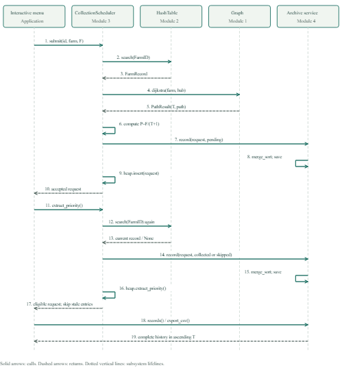

# Four-Module Integration

The application shares real objects between the modules. It does not exchange
manually typed transport times or priorities between separate programs.



[Editable PlantUML](module_integration_uml.puml) ·
[Vector rendering](module_integration_uml.svg)

The diagram uses UML subsystem lifelines, solid call arrows, dashed return
arrows and self-messages. `CollectionScheduler` includes the Module 3 Max Heap.
The Module 4 archive lifeline represents `SessionRecorder`, `CollectionDatabase`
and the internal manual sort/persistence operations. Guard checks and failure
responses are described below; the diagram shows the principal successful flow
and the dispatch status decision.

| Connection | Payload and actual operation |
|---|---|
| UI to Module 3 | `submit(RequestID, FarmID, EstimatedFeedstock)` |
| Module 3 to Module 2 | `HashTable.search(FarmID)` returns the complete 20-field `FarmRecord` |
| Module 3 to Module 1 | `Graph.dijkstra(FarmID, hub_id)` returns shortest minutes and path |
| Within Module 3 | `ScheduledRequest` calculates `P=F/(T+1)`; `MaxHeap.insert` percolates upward |
| Module 3 to Module 4 | The recorder receives the immutable request snapshot and `pending`, `collected`, `skipped` or `cancelled` status |
| Within Module 4 | Manual Merge Sort orders records by ascending T; SQLite stores explicit integer positions |
| UI to Module 4 | Display or export the sorted complete request history; Quick Sort can re-sort it |
| Sorting experiment to Modules 1-3 | Retrieve real farm records, cache Dijkstra results, create validated `ScheduledRequest` events and calculate their priorities |

The root menu owns a Graph, a shared HashTable and a persistent archive. Farm
deletion in root option 10 affects requests queued through option 11; option
12 still retains the complete historical snapshot. A hash reload rebinds the
existing scheduler. A graph change blocks stale priority snapshots until reset.
Network reload, scheduling reset and application exit retain cancelled history.
Session-prefixed RecordIDs preserve distinct requests after RequestID reuse in
a new session. No SQL `ORDER BY` or built-in sorting performs the T ordering.

Submission validates IDs, finite positive feedstock, existing farm records,
matching graph coordinates and a reachable route. RequestIDs are unique within
a session; only one request per farm can be pending. Dispatch checks the current
hash record before committing the outcome and removing the heap entry. Deleted
or changed farms are skipped without deleting their history. An archive write
failure is reported before queue mutation. Empty queues and missing data files
produce readable results/errors.

Run the complete normal scenario:

```bash
python interactive_menu.py --integrated-demo
```

Or run the explicit shared-deletion scenario:

```bash
python integration_demo.py --delete-farm doj25
```

Root menu option 13 runs the normal scenario in a fresh session while preserving
the active root-menu scheduler and archive. Normal interactive menus continue
to share their own live state. `--output-dir PATH` selects where evidence is
written. Repeated integration demos replace their named derived files rather
than duplicating historical rows in the normal interactive database.

Submitted evidence is in `sample_output/integration/`. Its normal scenario has
10 accepted, 10 extracted and 10 collected/archived requests; `deleted_farm/`
has all 10 archived, 9 collected and 1 skipped after `doj25` is deleted. Each
contains a log, eight successful data-flow checks, sorted CSV and SQLite copy.
Call-spy tests verify the real hash, Dijkstra and both manual sorting calls.

```bash
python -m unittest discover -s integration_tests -v
```
