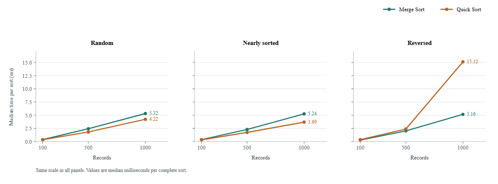

# Module 4 - Sorting Collection Records

## Design and sorting key

Both algorithms sort `CollectionRecord.transport_minutes` (T) in ascending
order. All production sorting is manual; no `sorted()`, `list.sort()` or SQL
`ORDER BY` performs the task. Tests use an independently written insertion-sort oracle.
Source/output/merge buffers are one-dimensional NumPy object arrays; no NumPy
sorting/searching function is called. Quick Sort defers ranges on the
student-written linked stack.

`merge_sort(records, key=transport_time, metrics=None)` implements **bottom-up
Merge Sort**. It doubles run width from 1 and alternates source/output buffers.
Taking the left item on equality makes it stable. Iteration avoids recursion
limits; the predictable O(n log n) worst case suits a persistent archive.
The code always completes each width pass and has no adaptive run shortcut.

`quick_sort(records, key=transport_time, metrics=None)` copies the input and
calls `quick_sort_in_place`. The pivot is the **median key of first, middle and
last**. Three-way partitioning finishes equal keys together. The smaller side
is processed first, while the larger is deferred on an explicit stack. The
partition core uses O(log n) stack space and avoids Python recursion limits.
Median-of-three helps initially ordered data but cannot guarantee balanced
partitions: O(n^2) worst-case time remains possible. With all equal keys the
three-way algorithm completes in O(n).

Merge is stable; Quick is unstable. For input `A:2, B:2, C:1`, Merge returns
`C:1, A:2, B:2`, while this Quick implementation returns `C:1, B:2, A:2`.
Stability concerns input order at that call. A later stable sort does not
restore an order changed by an earlier unstable sort.

Both public non-mutating APIs have O(n) total extra storage: Merge uses the
result/reference buffer plus a merge buffer; Quick uses a result copy plus
its O(log n) stack. The in-place Quick API avoids that O(n) result copy. Actual
memory use was not benchmarked. Optional metrics count key comparisons,
reference moves, partitions and maximum deferred ranges; they are disabled
during timing.

## Integrated request datasets

`generate_records` loads the full graph and actual Module 2 Hash Table. It
retrieves complete real farm records and calls actual Module 1 Dijkstra from
each of the 125 farms to the hub. It caches the 124 reachable routes and
explicitly excludes `gslqa`. Every generated T/path is copied from that cache.
It creates 1,000 unique historic request events; repeated FarmIDs represent
different events at the same real farm, not additional invented farms or
concurrently pending heap requests. Module 3 ScheduledRequest validates each
event and calculates its priority. Educational F values range from 2 to 30
tonnes and are not source-reported production figures.

Seed **23857030** fixes event selection and quantities. The 100- and 500-event
cases use prefixes of the 1,000-event base. Each size has the same multiset
under all three conditions. The condition seed is `seed + size*10 + index`,
where indices 0/1/2 mean random/nearly_sorted/reversed. An ascending baseline
is produced by our own stable Merge Sort. Random uses a seeded shuffle;
reversed swaps endpoints inward. Nearly sorted swaps disjoint sampled
positions: exactly 10/50/100 identities move, satisfying <=10% displacement.
Displacement is measured relative to the stable ascending baseline, including
moves among equal-T records. Actual descents and distinct-key counts are saved.

## Benchmark protocol and historical measured results

The table/chart below belong to the supplied snapshot and match
the unchanged PDF. The duplicate generated verification tree has been removed during package
cleanup. Run the benchmark command below to generate fresh measurements
for the current source. The complete benchmark source and tests are retained.

Run from the project root:

```bash
python -m module4_sorting.benchmark
python -m module4_sorting.benchmark --seed 23857030 --repeats 7 --number 25
python -m module4_sorting.test_driver
python interactive_menu.py --module sort --validate
```

Each algorithm/case receives one untimed warm-up, then seven `timeit` batches
of 25 complete sorts. The table reports median batch time divided by 25,
in milliseconds per sort. Copies are included. Dataset/route generation,
metrics, validation, printing, and CSV/SQLite I/O are excluded. Every timed
call gets the same unchanged NumPy object array. `timeit` disables cyclic GC during each
batch. Algorithm order alternates for the middle condition, rather than being
fully randomised. The seed reproduces input data; wall-clock times vary.

Times: median milliseconds per complete sort (copy included).

| Records | Condition | Merge ms | Quick ms | Quick / Merge |
|---:|---|---:|---:|---:|
| 100 | random | 0.365796 | 0.337636 | 0.923 |
| 100 | nearly_sorted | 0.360740 | 0.321604 | 0.892 |
| 100 | reversed | 0.279520 | 0.363648 | 1.301 |
| 500 | random | 2.431920 | 1.814360 | 0.746 |
| 500 | nearly_sorted | 2.287624 | 1.729504 | 0.756 |
| 500 | reversed | 2.017116 | 2.376216 | 1.178 |
| 1000 | random | 5.315344 | 4.220088 | 0.794 |
| 1000 | nearly_sorted | 5.244908 | 3.687876 | 0.703 |
| 1000 | reversed | 5.156768 | 15.116008 | 2.931 |



Merge was faster in three measured cases; Quick was faster in six. Increasing
n increased measured time for both algorithms, but the nine cases do not
establish asymptotic bounds. Merge's reversed cases needed fewer comparisons
while keeping the same number of buffer writes. At n=1,000, random/reversed
Merge comparisons were 8,671/5,710 with 10,000 writes in each case.

Quick's three-way partition helps with the many ties: at n=1,000 there are
113 distinct T values. Quick used 11,201 comparisons for random input and
18,986 for reversed. A median-of-three first pivot does not ensure equally
balanced later partitions. Nearly sorted was faster than random at 100, 500, and
1,000, showing that displacement placement and duplicate
frequency also matter. Minor differences at n=100 overlap some observed
batch ranges; no statistical significance claim is made. Theory remains
O(n log n) for Merge and usual average Quick behaviour, with a possible
O(n^2) Quick worst case. These inputs do not demonstrate a quadratic family.

The archive defaults to Merge for stable equal-T ordering and predictable
worst-case time. Quick is a useful alternative and can reduce working storage
through its in-place API, but observed wins are specific to this experiment.

## Persistent sorted request database

The normal root/heap interactive flow archives every accepted request before
heap insertion, with a complete farm snapshot. Dispatch updates its status to
`collected` or `skipped` without deleting history. Reset, network reload and
application exit mark remaining requests `cancelled`. Each session has a
prefix in its RecordIDs, so RequestIDs may be reused in later sessions without
losing older records. Invalid submissions stay as rejection messages.

SQLite saves application-calculated integer sort positions. `CollectionDatabase.save`
uses a manual Merge/Quick Sort, then atomically replaces positions. Relational
tables have no implicit order, so `records()` reads position 0, 1, ... explicitly;
SQL never sorts the transportation key. Default interactive persistence is
`collection_output/collection_records.sqlite3`. `--output-dir PATH` selects
another directory. Module 4 (root option 12) displays, re-sorts, imports modelled
historic events and exports sorted CSV. Every automatic archive update sorts
r records in O(r log r) plus record validation and persistence work; that cost
is separate from heap percolation and excluded from the benchmark.

`sample_output/sorting/collection_records.sqlite3` holds 1,000 sorted modelled
records. The separate `live_collection_demo.sqlite3` and matching sorted CSV
retain ten actual Module 3 submissions: nine collected, one skipped after farm
deletion. Historical examples and the runtime database are separate files.

## Deliverables and validation

- `algorithms.py`: both manual algorithms, key, validation and operation metrics.
- `datasets.py`: integrated route cache and seeded input arrangements.
- `records.py` and `database.py`: validated complete snapshots, CSV and SQLite storage.
- `benchmark.py`: nine cases, raw samples, result tables and metadata.
- `test_driver.py` and `interactive.py`: integrated demonstration and menu.
- `data/sort_inputs/`: all nine exact input CSVs.
- `sample_output/sorting/`: 18 sorted CSVs, timings, 126 raw samples, metadata,
  input hashes, chart, validation, real menu trace and two sorted databases.

**54 Module 4 tests pass; all 239 project tests pass.** Tests cover independent
sort oracles, stability, pivot duplicates, non-mutation, zero/fractional T,
real Dijkstra calls, data reproducibility/displacement, complete CSV round trips,
SQLite reopen and rank corruption, skipped/cancelled history, archive-write
failures, all benchmark cases and CLI integration.

```bash
python -m unittest discover -s module4_sorting/tests -v
python -m unittest discover -s . -v
```
